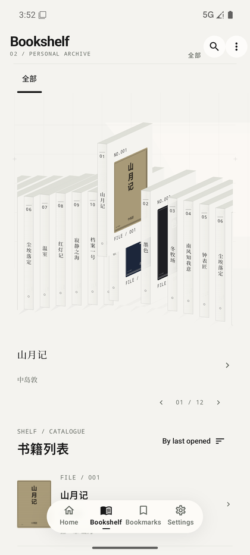

> **本仓库是 [sssdex](https://github.com/sssdex) 的个人改版，基于上游 [AzukiPann/AzukiReader](https://github.com/AzukiPann/AzukiReader) `1.00.12`。**
> 独立仓库（不是 GitHub fork，所以能出现在 GitHub 默认搜索里）；同步上游用 `upstream` 远程手动合并，见 [FORK-NOTES.md](FORK-NOTES.md)。
> 只改了书架的三个小地方，阅读器、书源、同步等都没动：
> ① 横滑书架**每跨一本轻振**（15ms / 振幅 150，直接走 Vibrator）
> ② 封面上下编号**往里收**（`NO.001` / `FILE / 001` 离书口从 10dp 收到 18dp）
> ③ 书脊与书名的**字体换成思源宋体**并按这个书架的实际尺寸收小字号（实测比照搬更合适）
>
> 顺手修了两个问题：④ **省电模式下立体书架会变成平铺卡片**（原来跟 `isPowerSaveMode` 绑在一起，
> 现在省电也保留 3D）⑤ **朗读设置页偶发 NPE 崩溃**（听书状态构建加了兜底）。
>
> 又调了两处观感：⑥ **切标签页不再「旧页留着、新页叠上来」**（只画当前页，擦除 420ms → 200ms）
> ⑦ **立体书架铺满屏幕宽度**（不再跟书目一样留 24dp 两边空白）。
>
> 版本 `1.00.12-mod.3` · 安装包见 [Releases](../../releases) · 改动清单/构建方式/致谢见 **[FORK-NOTES.md](FORK-NOTES.md)**
>
> 上游作者的说明（界面示意、与 MD3 版的区别等）保留在下方。

  

  

# AzukiReader

基于 **Legado 的阅读能力**，使用 **Wenku8 Flutter 的档案式界面与动效风格**制作的 Android 阅读应用。

纯vibecoding产物,仅用于满足个人需求后续不会更新

## 界面示意

  
  

## 基于哪些项目

| 项目                                                         | 本项目使用的部分                                             |
| ------------------------------------------------------------ | ------------------------------------------------------------ |
| [HapeLee / legado-with-MD3](https://github.com/HapeLee/legado-with-MD3) | Android 应用主体、Kotlin / Compose 工程、书源与阅读业务、数据库、下载缓存、同步及原有阅读器能力。 |
| [P5UEDGK / Wenku8_Flutter](https://github.com/P5UEDGK/Wenku8_Flutter) | 界面美术、档案式排版、玻璃导航、立体书架、动效与性能设置，以及在线听书实现的参考。相关能力在现有 Android 工程中适配。 |

## 与 Legado MD3 版的主要区别

以下对比针对本项目移植时使用的 Legado MD3 基线，不代表上游未来版本的功能状态。

| 方面         | AzukiReader 的调整                                           |
| ------------ | ------------------------------------------------------------ |
| 整体外观     | 采用 Wenku8 风格的暖白纸色、细线、英文档案标识、导航序号与网格背景；设置、菜单和弹窗使用对应视觉样式。 |
| 导航与动画   | 使用玻璃胶囊导航、按压形变和切换回弹，加入文字分段出现等动效；调整页面、阅读器和设置子页过渡，减少切换闪烁。 |
| 导航入口     | 书签单独占据底栏入口；发现和订阅默认隐藏，可在设置中恢复，标题编号随可见导航计算。 |
| 书架         | 上方为可隐藏的立体书架，下方为完整列表或网格；立体书架数量可设置为 1–100 本，默认 12 本，封面未加载时保留白书占位。 |
| 分组与排序   | 增加抽屉式分组布局；书架默认列表展示，默认按最后打开的书籍排序，并同步最近阅读状态。 |
| 书签与摘录   | 阅读工具栏加入书签入口；用当前页及同章下一页的连续正文自由选取摘录，本章最后一页只提供当前页；支持一键将全部摘录导出为 Markdown。 |
| 阅读数据     | 支持阅读数据 JSON 导入、导出；记录当前位置及章内比例，另在阅读记录中展示最高章节标题、章节数/总章节和章内比例。 |
| 每日阅读统计 | 每本书的同一设备记录按自然日累计时长，反复打开不会每次新增一条记录；跨午夜分日，重复导入日快照避免重复计时。 |
| 刷新率与动效 | 阅读界面刷新率单独设置，默认请求 30 Hz；增加性能与动效设置及轻量降级。实际刷新率由设备和系统决定。 |
| 朗读设置 | 设置与阅读器共用音色、倍速及定时控制，应用全局音色；删除前确认，另支持 DeepSeek 海星女声与暗潮男声。 |

朗读设置的修改与验证记录见 [功能说明](features/readaloud-unification/README.md)，1.00.10 安装包及校验记录见 [发布说明](features/release-1.00.10/README.md)。
