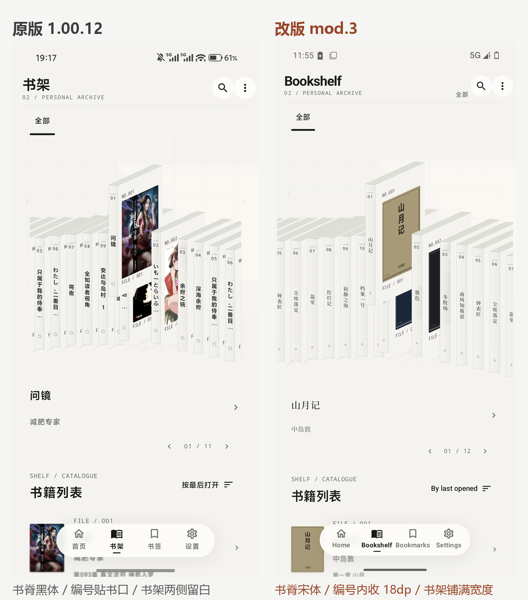
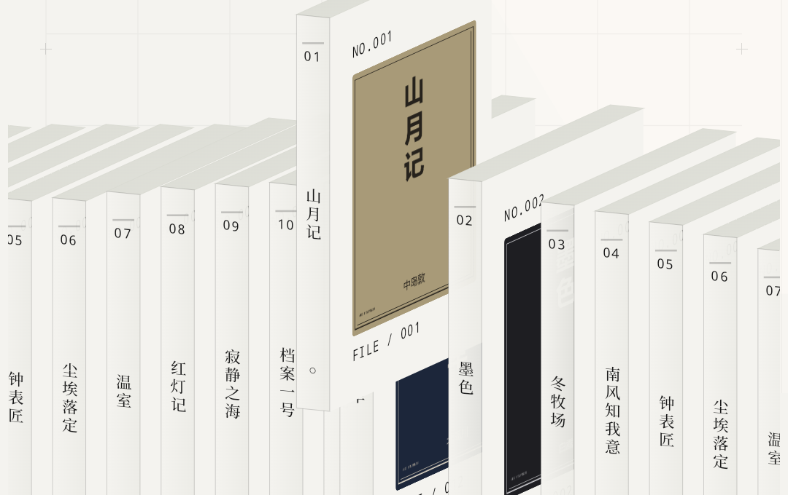
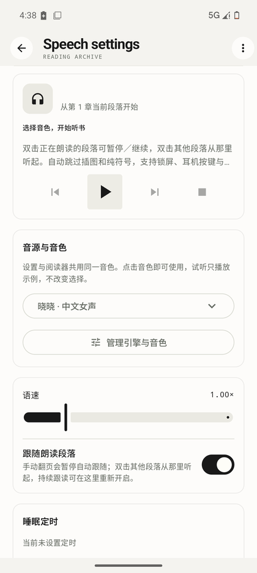
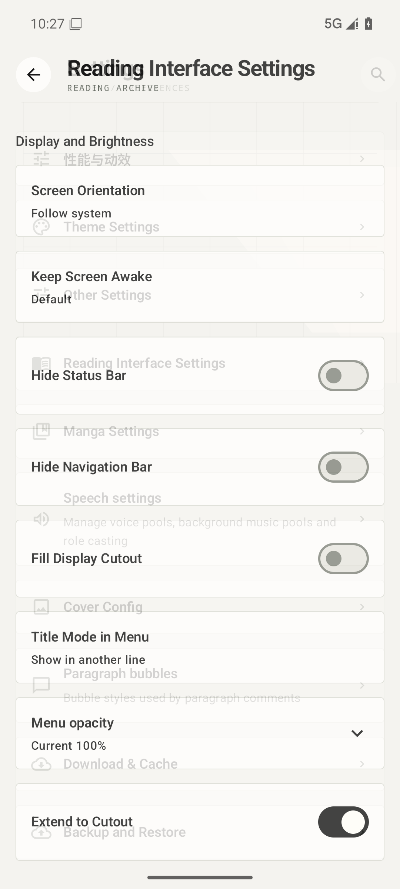
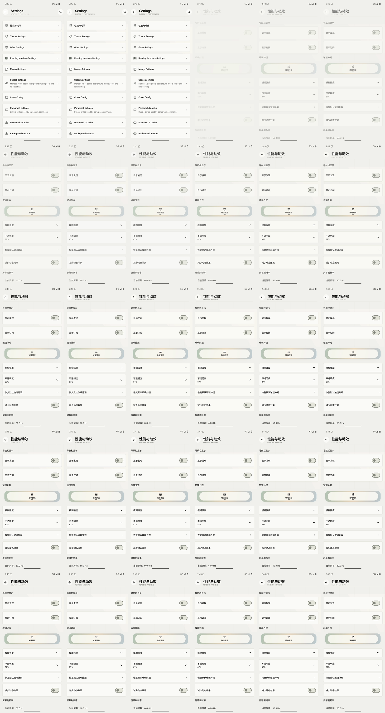
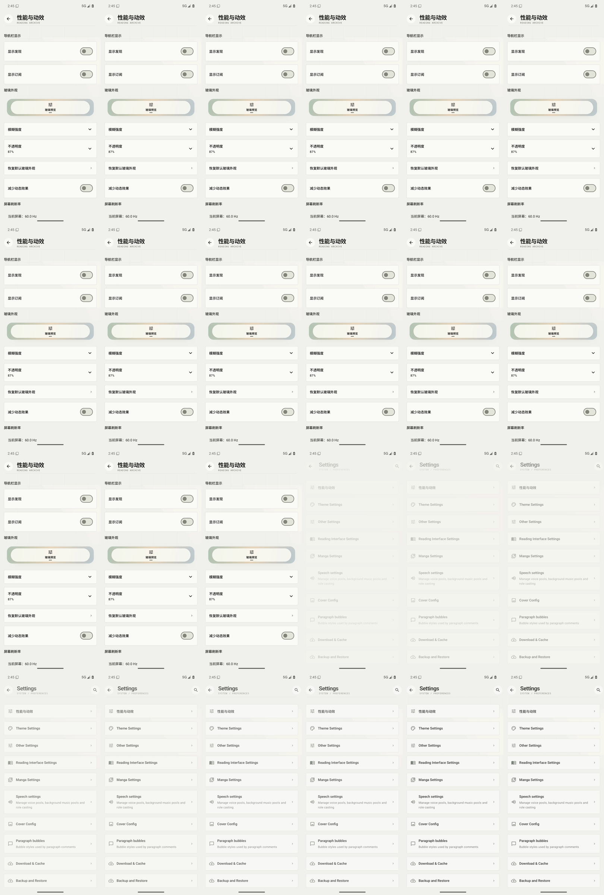

  
  <h2>AzukiReader · 个人改版</h2>
  
在上游 <code>1.00.12</code> 上只动书架与页面转场，另外修好五个问题

  

    <a href="https://github.com/sssdex/AzukiReader-Shelf/releases/latest"><b>⬇ 下载 APK</b></a>
    &nbsp;·&nbsp;
    <a href="FORK-NOTES.md">改动清单与代码位置</a>
    &nbsp;·&nbsp;
    <a href="README-UPSTREAM.md">原版说明</a>
  

  最新版 <code>1.00.12-mod.3.1</code> · 包名 <code>io.azukireader.app</code> · 与官方版同签名，可直接覆盖安装

 

## 改了什么（左：原版 / 右：改版）

| 位置 | 原版 1.00.12 | 改版 mod.3.1 |
| --- | --- | --- |
| **书架横滑** | 只有 Compose 的 `SegmentFrequentTick`，强度由系统触摸反馈决定，实机几乎感觉不到 | 每跨过一本书直接调 `Vibrator`：**15ms / 振幅 150**（截图看不出来，实机滑一下就知道） |
| **封面编号** | `NO.xxx` / `FILE / xxx` 离书口 10 / 9 / 8dp，贴着裁切线 | 收到 **18 / 12 / 11dp**，往里让出书口 |
| **书脊与书名** | 系统黑体，书脊 9sp、下方书名 17sp 加粗、作者 12sp | **思源宋体**（GB2312 子集），按这个书架 100–128dp 的封面实测收到 **8.2 / 16 / 11sp** |
| **书架宽度** | 跟档案书目一样吃 24dp 横向内边距，两边各留一条空白 | 书脊**铺满屏幕两边**，书名行仍在原边距 |
| **切标签页** | 旧页保持不透明，新页用 420ms 斜向擦除盖上来；掉帧时两页文字叠在一起 | **只画当前页**，擦除 200ms，旧页瞬间移除，不再有重影 |
| **设置页切界面** | 离场页 alpha 钉在 1、进场页从 0 淡入，二级/三级菜单切换时两页文字同时可见（叠影） | 原版淡入**一行不改**（200ms、曲线、起止透明度都不变），只把离场页改成转场开始就淡到 0、不再垫在下面——任何一帧只有一页参与合成，字不会叠 |
| **省电模式** | `shelf3d` 跟 `isPowerSaveMode` 绑死，电量低自动降级成平铺卡片，看起来像书架丢了 | 省电模式**保留立体书架**（书架是静态绘制，不吃帧） |
| **朗读设置** | 偶发 `NullPointerException` 崩溃（听书状态构造链） | 状态构建加兜底，异常时退回「未开始听书」，不再整页崩 |

 

## 截图

| 书架：宋体书名、编号内收、铺满宽度 | 书脊与编号细节 |
| --- | --- |
|  |  |

  
   
  朗读设置：崩溃已兜底，能正常打开

 

## 设置页转场（mod.3.1）

同一次「设置 → 阅读界面设置」的切换，用 `animator_duration_scale = 10` 放慢后逐帧截的中间帧：

| 原版 1.00.12：两页文字叠在一起 | 改版 mod.3.1：进入（任何一帧只有新页在淡入） |
| --- | --- |
|  |  |

  
   
  返回方向：同样只有目的地一页在淡入

左边是原因：离场页 alpha 固定为 1、进场页从 0 淡入，半透明的新页压在不透明的旧页上，
副标题会出现 `READING / ARCHIVE` + `ENCES` 两截，列表也上下各一套。

右边是改法：新页的淡入**原样保留**（200ms + 原曲线，从 0 到 1，一项没动），
只把离场页改成转场一开始就淡到 0——它不再垫在下面参与合成，淡入期间透出来的是
已同步成主题背景色的窗口背景，所以观感仍是「新页在原来的底色上淡进来」，不会黑一下或空一下。
（`ExitTransition.None` 不行——离场页会保持不透明留在下面，实测照样叠影。）

模拟器 `gfxinfo` 同脚本对比 5 次进出二级页：掉帧比例 mod.3 73.56% → **mod.3.1 34.48%**
（p50 69→40ms、p99 150→105ms、Missed Vsync 44→12）。中间的 mod.4（不透明浅推）、
mod.5（淡出错开）都因改掉了原版动画手感被撤销，本版从 mod.3 源码重建。

## 版本与安装

| 版本 | 内容 |
| --- | --- |
| `1.00.12-mod.3.1` | **当前版本**：设置页叠影消除——原版淡入原样保留，离场页转场开始即淡出，掉帧比例 73.56% → 34.48% |
| `1.00.12-mod.5` | 已撤销：淡出错开虽不叠了，但中间有一段整页空掉，等于把原版动画删了 |
| `1.00.12-mod.4` | 已撤销：不透明浅推改了动画手感、部分机器更卡 |
| `1.00.12-mod.3` | 底部标签页切换不再叠页；立体书架铺满宽度 |
| `1.00.12-mod.2` | 省电模式保留 3D、朗读设置兜底 |
| `1.00.12-mod` | 书架轻振、编号内收、宋体书名 |

- 包名仍是 `io.azukireader.app`，用自签 keystore 签名，与本仓库的旧版本可以互相覆盖；
  装过**官方 1.00.12** 的话需要先卸载（签名不同）。
- APK 都挂在 [Releases](../../releases)；每个版本的说明里写了 md5 和改动细节。

 

## 已知限制

- 轻振依赖系统「触摸振动」开关，关掉后不会有反馈。
- 字体是 GB2312 子集（6763 汉字 + ASCII + 常用标点），生僻字回落到系统字体。
- 朗读设置那次崩溃在本地模拟器复现不出来（Android 16 复现、机型是 Android 17），
  所以做的是防御性兜底，不是确诊修复；如果再崩欢迎贴日志。

 

---

本仓库是 [sssdex](https://github.com/sssdex) 的个人改版（独立仓库，不是 GitHub fork，所以能被默认搜索索引到），
基于 [AzukiPann/AzukiReader](https://github.com/AzukiPann/AzukiReader) `1.00.12`，只改书架、保存/阅读/书源等逻辑未动；
同步上游用 `upstream` 远程手动合并（见 [FORK-NOTES.md](FORK-NOTES.md)）。
原版界面示意与功能对比见 [README-UPSTREAM.md](README-UPSTREAM.md)，逐条实现与致谢见 [FORK-NOTES.md](FORK-NOTES.md)。
上游未声明 License，本改版仅作个人使用。
